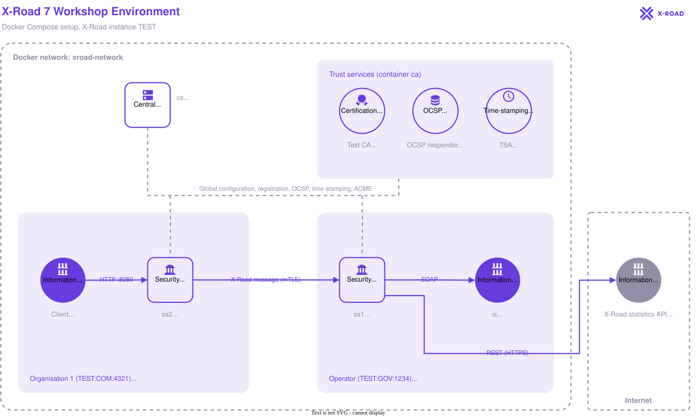

# X-Road 7 Workshop Environment

A local X-Road 7 test environment for the workshop, run with Docker Compose. It contains a Central Server, a test CA, two Security Servers and an example information system that provides test SOAP services.

The setup follows the NIIS Knowledge Base article [How to Set Up a Local Test Environment Using Docker Compose](https://nordic-institute.atlassian.net/wiki/spaces/XRDKB/pages/281739671/How+to+Set+Up+a+Local+Test+Environment+Using+Docker+Compose) and adds pre-made configuration files, helper scripts and example requests.

## Overview

The environment consists of the following containers, all attached to the bridge network `xroad-network`:

1. `cs`: Central Server (`niis/xroad-central-server:noble-7.8.3`).
2. `ca`: test CA with an OCSP responder, a TSA and an ACME server (`ghcr.io/nordic-institute/xrddev-testca:latest`).
3. `ss1`: Security Server for the management services provider and the service provider (`niis/xroad-security-server-sidecar:7.8.3`).
4. `ss2`: Security Server for the service consumer (`niis/xroad-security-server-sidecar:7.8.3`).
5. `is`: example information system that provides the test SOAP services (`niis/example-adapter:latest`). `ss1` reaches it at `http://is:8080/example-adapter/Endpoint`; from the host it listens on port `3080`.

Configuration and data are stored in named volumes, so you can recreate the containers without losing their state. See [Volumes and Resetting](#volumes-and-resetting).



The diagram is drawn with the X-Road draw.io library. Its source is [`docs/workshop-environment.drawio`](docs/workshop-environment.drawio).

## Run the Containers

Start the environment from the repository root:

```bash
docker compose up -d
```

Follow the logs of all containers:

```bash
docker compose logs -f
```

Follow the logs of a single container, for example `ss1`:

```bash
docker logs -f ss1
```

> [!WARNING]
> The Central Server image is intended for testing only. Do not use it in production.

When the containers are running, configure the environment with the [Configuration Guide](docs/configuration-guide.md).

## Members and Subsystems

The workshop builds the following X-Road instance `TEST`. Member classes are `COM` (Companies) and `GOV` (Government).

| Member name | Member identifier | Subsystem | Subsystem role | Security Server |
| --- | --- | --- | --- | --- |
| Operator | `TEST:GOV:1234` | – | Security Server owner | `ss1` |
| Operator | `TEST:GOV:1234` | Management (`TEST:GOV:1234:MANAGEMENT`) | Management services provider | `ss1` |
| Operator | `TEST:GOV:1234` | Test Service (`TEST:GOV:1234:TestService`) | Service provider | `ss1` |
| Organisation 1 | `TEST:COM:4321` | – | Security Server owner | `ss2` |
| Organisation 1 | `TEST:COM:4321` | Test Client (`TEST:COM:4321:TestClient`) | Service consumer | `ss2` |

`TestService` provides the following services. `TestClient` has access rights to all of them.

| Service | Version | Type | Service URL |
| --- | --- | --- | --- |
| `getRandom` | `v1` | SOAP (WSDL) | `http://is:8080/example-adapter/Endpoint` |
| `helloService` | `v1` | SOAP (WSDL) | `http://is:8080/example-adapter/Endpoint` |
| `listPeople` | `v1` | SOAP (WSDL) | `http://is:8080/example-adapter/Endpoint` |
| `personDetails` | `v1` | SOAP (WSDL) | `http://is:8080/example-adapter/Endpoint` |
| `XRoadStatistics` | – | REST (OpenAPI 3) | `https://api.stats.x-road.global/v1` |

Add the SOAP services with the WSDL address `http://is:8080/example-adapter/Endpoint?wsdl`.

The connection type of `TestClient` is HTTP.

## Configuration

For step-by-step instructions, see the [Configuration Guide](docs/configuration-guide.md).

Use these values when following the X-Road configuration guides:

| Setting | Value |
| --- | --- |
| Central Server address | `cs` |
| Software token PIN (`XROAD_TOKEN_PIN`) | `123456xrd!` |
| OCSP responder URL | `http://ca:8888` |
| TSA URL | `http://ca:8899` |
| Security Server DNS names for authentication certificates | `ss1`, `ss2` |

The user interfaces are available at:

| Component | Address | Credentials |
| --- | --- | --- |
| Central Server | <https://localhost:4000> | `xrd` / `secret` |
| Security Server `ss1` | <https://localhost:1000> | `xrd` / `secret` |
| Security Server `ss2` | <https://localhost:2000> | `xrd` / `secret` |
| Test CA | <http://localhost:8888/testca/> | – |

> [!WARNING]
> Do not use several user interfaces in the same browser at the same time, because their sessions conflict. Use separate browsers or private windows instead.

### Configuration Files

`config/<server>/` contains the files copied to `/etc/xroad/conf.d` in each container:

| File | Servers | Configures |
| --- | --- | --- |
| `local.ini` | `cs` | Automatic approval of authentication certificate registration, client registration and owner change requests. |
| `local.ini` | `ss1`, `ss2` | ACME challenge port and automatic activation of authentication and ACME signing certificates. |
| `mail.yml` | `ss1`, `ss2` | Mail server and member contacts for notifications and ACME. |
| `acme.yml` | `ss1`, `ss2` | ACME external account binding (EAB) credentials. |

> [!NOTE]
> `mail.yml` and `acme.yml` contain credentials. The values in this repository are test values only.

[`config/copy-config.sh`](config/copy-config.sh) is the container entrypoint. On the first startup of a fresh configuration volume it copies the files and creates the marker file `/etc/xroad/conf.d/.workshop-config-copied`, then runs the image's own entrypoint. On later startups it skips the copy.

The files are copied only once because X-Road writes to them itself: a Security Server stores its generated ACME `account-keystore-password` in `acme.yml`, and the Central Server adds API tokens to `local.ini`.

To apply changes made to the files in the repository, do one of the following:

* Start from scratch with `docker compose down -v`. This removes all volumes, see [Volumes and Resetting](#volumes-and-resetting).
* Delete the marker file and restart the container, for example for `ss1`:

  ```bash
  docker exec ss1 rm /etc/xroad/conf.d/.workshop-config-copied
  ```

  ```bash
  docker compose restart ss1
  ```

> [!WARNING]
> On a Security Server, recopying replaces `acme.yml` with the repository copy, whose keystore password is empty. The password generated by the Security Server is lost.

### CA Certificates

The `ca` container generates its certificates on the first start of the `ca-data` volume. A new volume means a new CA with new keys, even though the certificate names stay the same.

Copy the CA, OCSP responder and TSA certificates to `certs/` (git-ignored):

```bash
scripts/export-ca-certs.sh
```

Upload them to the Central Server:

* `certs/ca.pem` as the CA certificate, with `certs/ocsp.pem` as the OCSP responder certificate.
* `certs/tsa.pem` as the TSA certificate.

Run the script again whenever the `ca-data` volume is recreated.

## Testing the Environment

The consumer ports of the Security Servers are:

| Security Server | HTTP (in network / from host) | HTTPS (in network / from host) |
| --- | --- | --- |
| `ss1` | `8080` / `1080` | `8443` / `1443` |
| `ss2` | `8080` / `2080` | `8443` / `2443` |

The connection type of the client subsystem decides which port to use. `TestClient` uses HTTP, so send its requests to `http://ss2:8080` inside `xroad-network` or `http://localhost:2080` from the host.

### Sending Requests

[`scripts/send-request.sh`](scripts/send-request.sh) runs curl (`curlimages/curl:8.11.1`) in a container attached to `xroad-network`, so the servers can be reached by their container names. All arguments are passed to curl as-is. The script hides curl's progress meter by default; add `--progress-meter` to show it.

JSON and XML responses are pretty-printed by [`scripts/format-response.py`](scripts/format-response.py), which runs in a `python:3.13.1-alpine` container, so Python doesn't need to be installed on the host: the script only needs bash and Docker. Response headers printed with `-i` and other content types, such as YAML, are shown unchanged. To print the response exactly as received, pass `--raw` as the first argument:

```bash
../scripts/send-request.sh --raw -d @getRandom.xml --header "Content-Type: text/xml" -X POST http://ss2:8080
```

The first request downloads the curl and Python images, so it takes longer than the following ones.

The current directory is mounted as the working directory, so `-d @file.xml` works for files under it but not for paths such as `../file.xml`. Run the script from the `requests` directory:

```bash
cd requests
```

```bash
../scripts/send-request.sh -d @getRandom.xml --header "Content-Type: text/xml" -X POST http://ss2:8080
```

`requests/` contains these example requests from `TestClient` to `TestService`:

* `getRandom.xml`: calls `getRandom`.
* `helloService.xml`: calls `helloService`.
* `listMethods.xml`: calls the X-Road metaservice `listMethods`, which lists the services of `TestService`.

## Adding Your Own Services

Add your own services to a provider subsystem on `ss1` and use `ss2` as the consumer. Before calling a service, check the connection type of the client subsystem, because a wrong connection type causes an error.

To test your own information system, add it as a service in `docker compose` attached to `xroad-network`, like `is` in [`compose.yaml`](compose.yaml). Security Servers can then reach it by its container name.

## Volumes and Resetting

Each container stores its state in named volumes (for example `cs-conf-data`, `ca-data`, `ss1-db-data`), defined in [`compose.yaml`](compose.yaml).

To remove the containers and all volumes, including the CA and its keys:

```bash
docker compose down -v
```

## License

This project is licensed under the MIT License. See [LICENSE](LICENSE).
